# FingerprinterJS

**Browser signatures you can inspect.** Collect browser observations locally, hash an explicit stable projection, and understand the result through typed diagnostics.

[Interactive demo](https://lorenzo-coslado.github.io/fingerprinter-js/) · [API](docs/API.md) · [Migration from v2](docs/MIGRATION.md) · [Data collection](docs/PRIVACY.md) · [Contributing](CONTRIBUTING.md)

MIT licensed. TypeScript. No runtime dependencies, account, telemetry or network requests by default.

> This branch contains **v3.0.0**, including breaking changes to fingerprints and defaults. Until v3 is published, npm and the live demo may still serve v2. To try this checkout, use the local demo or build a package as described below.

## Get started

After v3 is published:

```sh
npm install fingerprinter-js
```

```ts
import { Fingerprint } from 'fingerprinter-js';

// Call from a browser event or lifecycle, when collection is authorized.
const result = await Fingerprint.generate();

console.log(result.fingerprint); // SHA-256 browser environment signature
console.log(result.fingerprintVersion); // '3' — the identification schema
console.log(result.collectionCoverage); // successful / selected collectors, 0–100
console.log(result.collectorResults); // states, durations and observations
```

Importing the package is safe during server rendering. **Collect in the browser.** A signature can change when the environment, selected collectors or available observations change. Different environments can share it. It does not authenticate a device or establish that a visitor is human.

## How it works



Only successful, explicitly selected identification fields enter the hash. Resolution, zoom, browser version strings, storage quota, battery, connection, permission states and device counts stay outside it. The [complete projection table](docs/API.md#profiles-and-schema-3) describes schema 3.

The package version and fingerprint schema are separate. Store `fingerprintVersion` with the hash, and read the [migration guide](docs/MIGRATION.md) before upgrading.

## Choose the collection you need

| Profile              | Purpose                                  | Selection                                                           |
| -------------------- | ---------------------------------------- | ------------------------------------------------------------------- |
| `minimal`            | Small configuration signature            | Language, timezone, hardware, touch, math                           |
| `balanced` — default | Rendering and configuration observations | Minimal plus user agent, screen, canvas, WebGL, fonts, Client Hints |
| `diagnostic`         | Inspect optional browser capabilities    | All built-ins except WebRTC                                         |

More observations do not imply a measured accuracy improvement. Choose a profile for its purpose, cost and data effects. Use an exact list when you need tighter control:

```ts
const result = await Fingerprint.generate({
  collectors: ['language', 'timezone', 'canvas'],
  timeout: 500, // each collector
  timeBudget: 800, // shared collection budget
  includeComponents: false,
});
```

`includeComponents: false` omits raw observations from both result locations, while retaining statuses and timing. It reduces the returned data, not the collection itself. Default profiles make no network requests. WebRTC requires explicit selection and `network: 'enabled'`; no public STUN server is hardcoded.

## Handle partial results

```ts
const controller = new AbortController();
const agent = new Fingerprint({ profile: 'balanced', timeBudget: 1_000 });
const result = await agent.generate({ signal: controller.signal });

for (const [name, collection] of Object.entries(result.collectorResults)) {
  if (collection.status !== 'ok' && collection.status !== 'excluded') {
    console.log(name, collection.status, collection.reason);
  }
}
```

States distinguish `ok`, `unsupported`, `blocked`, `timeout`, `error`, `excluded` and `aborted`. Cancellation returns partial results and releases registered resources. Empty selections have zero coverage and `quality: 'empty'`; their deterministic hash is not a usable unique identifier.

**Coverage is availability, not identity accuracy.** `confidence` remains a deprecated alias for coverage. `entropy` is `null`: this library does not estimate population entropy or publish an unmeasured precision percentage.

## Keep request context outside identification

```ts
const result = await Fingerprint.generate({
  customData: { requestId: 'request-123', timestamp: Date.now() },
});
// Context is preserved in components.custom and does not affect the hash.
```

If application data must explicitly contribute, use `fingerprintData` and optionally a public `namespace`. UUIDs are preserved, object keys are sorted recursively and array order is retained. Unsupported JSON data is rejected explicitly. See [API contracts](docs/API.md).

## Explain changes and automation indicators

```ts
import { compareFingerprints, SuspectAnalyzer } from 'fingerprinter-js';

const comparison = compareFingerprints(previous, current);
console.log(comparison.sameVersion, comparison.changes);

const result = await Fingerprint.generate({ includeSuspectAnalysis: true });
const replay = SuspectAnalyzer.analyze(result.components);
```

Comparison shows changes in available observations; not every observation enters the hash. The analysis replays a versioned snapshot of explicit automation and declared crawler indicators. Its score is a heuristic weight, **not a fraud probability**. Missing APIs, privacy defenses, international language choices and successful collection are not bot evidence.

Browser data can be forged or omitted. Use these observations alongside trusted application signals, never as authentication or the sole basis for blocking a person. Read the [security policy](SECURITY.md) and [ecosystem decisions](docs/ECOSYSTEM.md).

## Try it and run the tests

```sh
git clone https://github.com/Lorenzo-Coslado/fingerprinter-js.git
cd fingerprinter-js
npm ci
npm run demo
```

Open `http://127.0.0.1:4173`. The demo uses the current local SDK, starts collection only when requested and includes profile controls, component inspection, repeatability checks, safe diagnostic export and in-browser self-tests.

```sh
npm run check              # lint, types, unit tests, build and packed consumers
npm run test:coverage
npm run test:mutation      # prove that a constant hash makes regression tests fail
npx playwright install chromium firefox webkit
npm run build:demo
npm run test:browser       # SDK + demo, three browser engines
```

To install this checkout in another application, run `npm run build && npm pack --ignore-scripts`, then install the generated `.tgz`. Every public entry is checked from that archive through ESM, CommonJS and TypeScript consumer projects. CI runs on pull requests; the Pages workflow builds the demo with the same source SDK. [Release setup](docs/RELEASING.md) documents the required npm/GitHub settings.

## Compatibility and scope

The browser target is ES2020 with modern browser APIs, feature detection and explicit degradation. The repository's browser suite targets current Chromium, Firefox and WebKit. WebKit testing is not a certification of every Safari/iOS release; mobile hardware and older browser versions require validation in the target integration.

Development tools require Node 22.22.2+, 24.15+ or 26+. The SDK's browser runtime has no npm dependencies. Network collectors, optional high-entropy browser APIs and raw diagnostics deserve separate review for each deployment. [Privacy and collection effects](docs/PRIVACY.md) explains purpose, minimization and integration responsibilities.

For custom collectors, direct collector imports, sequential collection and the complete typed result, see [API](docs/API.md). For fixes and compatibility changes, see [CHANGELOG](CHANGELOG.md).

## License

[MIT](LICENSE) © Lorenzo Coslado. Contributions and reproducible bug reports are welcome through the [contribution guide](CONTRIBUTING.md).
